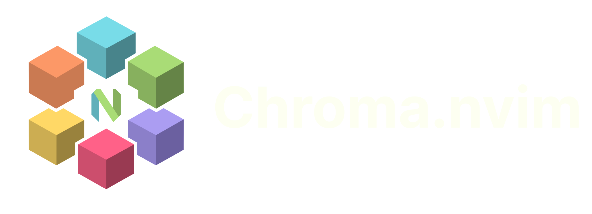

<div align="center">
  
</div>


<div align="center">
Lightweight, fast and customizable Lua theming engine for Neovim <br> with 99+ built-in base46-compatible colorschemes.
</div>

</br>

<div align="center" style="display: flex;">
  <a href="https://dotfyle.com/Malick-Tammal/chroma.nvim">
    
  </a>
  
  <a href="https://dotfyle.com/Malick-Tammal/chroma.nvim">
    
  </a>
  
  <a href="https://github.com/malick-tammal/chroma.nvim/contributors"></a>

  <a href="https://github.com/malick-tammal/chroma.nvim/network/members"></a>
</div>

---


A small, data-driven colorscheme engine for Neovim. Themes are plain palette
files; the engine owns every highlight group.

``` lua
themes/<name>.lua     -- Palette only (base_30 + base_16 + type)
polish/<name>.lua     -- Optional highlight overrides
highlights/           -- Group definitions, shared by every theme
colors/ch-<name>.lua  -- :colorscheme shims
```

Ships **99+ themes**: 98 vendored from [NvChad/base46](https://github.com/NvChad/base46)
and the locally made `monokai-fusion`. The themes use the base46-compatible
palette schema, so any base46 theme also works.

## Requirements

- Neovim 0.9+
- [`telescope.nvim`](https://github.com/nvim-telescope/telescope.nvim) is optional and only used by `:Chroma pick`
- [`lualine.nvim`](https://github.com/nvim-lualine/lualine.nvim) is optional and enables the built-in Lualine theme

## Install
Using [Lazy.nvim](https://github.com/folke/lazy.nvim)

```lua
return {
  "malick-tammal/chroma.nvim",
  lazy = false,
  priority = 1000,
  config = function()
    require("chroma").setup {
      theme = "monokai-fusion",
      transparency = false,
      persist = true,
      overrides = {
        -- CursorLine = { bg = "one_bg" },
        -- FloatBorder = { fg = "blue" },
      },
    }
  end,
}
```

By default, selecting a theme via `:Chroma apply`, the picker, `:colorscheme`, or `chroma.apply()` saves it to `stdpath("state")/chroma/current`. The saved theme overrides `setup { theme = ... }` on the next startup. Run `:Chroma reset` to clear it and return to the configured default. Persistence can be disabled with `persist = false`.

## Configuration

All options are passed to `require("chroma").setup({})`.

<details>
<summary>Default Options</summary>

```lua
require("chroma").setup {
  -- Theme applied on startup when no valid saved theme exists.
  theme = "monokai-fusion",

  -- Make common backgrounds transparent.
  transparency = false,

  -- Save the active theme under stdpath("state")/chroma/current.
  -- On the next startup, the saved theme overrides `theme`.
  persist = true,

  -- Optional highlight overrides. Accepts a table or function(palette, theme).
  overrides = nil,
}
```

`overrides` can be a static table:

```lua
overrides = {
  CursorLine = { bg = "one_bg" },
  FloatBorder = { fg = "blue" },
},
```

Or a function returning one:

```lua
overrides = function(palette, theme)
  return {
    CursorLine = { bg = palette.one_bg },
    FloatBorder = { fg = palette.blue },
  }
end,
```

</details>

## Usage
Commands:
```vim
:colorscheme ch-monokai-fusion    " Any shipped theme: ch-<name>
:Chroma pick                      " Opens the theme picker
:Chroma list                      " Lists the available themes
:Chroma apply tokyonight          " Apply theme by name
:Chroma current                   " Get current theme name
:Chroma reset                     " Remove the saved theme, use the configured theme
:checkhealth chroma               " Check chroma.nvim health
```

From Lua:
```lua
local chroma = require("chroma")

-- Setup (usually done in your Neovim config)
chroma.setup {
  theme = "monokai-fusion",
  transparency = false,
  persist = true,
  -- overrides = function(palette, theme) return { ... } end,
}

-- Apply any shipped theme
chroma.apply("monokai-fusion")

-- Control what happens on apply
chroma.apply("tokyonight", {
  quiet = false,       -- false by default; true disables the notification
  persist = true,     -- false leaves stdpath("state")/chroma/current untouched
  fire_event = true,   -- true fires ColorScheme; false suppresses it
})

-- Query the current state
print(chroma.current())         -- "monokai-fusion" (or nil before setup)
print(table.concat(chroma.list(), ", "))

-- Inspect the resolved palette
local palette = chroma.palette()
print(palette.black, palette.red, palette.yellow)

-- Refresh the cached theme list (only needed if you add themes at runtime)
chroma.refresh()
```

## Features

- 99+ built-in themes: 98 vendored from [NvChad/base46](https://github.com/NvChad/base46)
  and `monokai-fusion`, using the base46-compatible palette schema.
- Data-driven highlight engine for syntax, Treesitter, LSP, semantic tokens and plugins.
- Transparent background support and per-theme/user highlight overrides.
- Persistent theme selection across restarts; you can reset back to the configured default.
- Telescope picker with inline palette swatches and a full palette preview.
- Light/dark background detection and contrast-aware foregrounds.
- Exactly one `ColorScheme` event per theme switch, so statuslines and bufferlines update naturally.
- Built-in Lualine theme with readable mode accents.
- `:checkhealth chroma` reports themes, integrations and configuration problems.
- Add your own theme by dropping a palette file in `themes/` — no engine changes required.

<details>
<summary>Supported Plugins</summary>

All themes also ship highlights for Neovim’s defaults, syntax, Treesitter, LSP, and semantic tokens. The plugin integrations are:

| Plugin | Integration key |
|---|---|
| telescope.nvim | `telescope` |
| bufferline.nvim | `bufferline` |
| nvim-cmp | `cmp` |
| snacks.nvim | `snacks` |
| neo-tree.nvim | `neo-tree` |
| mini.nvim | `mini` |
| noice.nvim | `noice` |
| nvim-notify | `notify` |
| yanky.nvim | `yanky` |
| which-key.nvim | `whichkey` |
| render-markdown.nvim | `render-markdown` |
| lspsaga.nvim | `lspsaga` |
| inc-rename.nvim | `inc-rename` |
| gitsigns.nvim | `gitsigns` |
| flash.nvim | `flash` |
| todo-comments.nvim | `todo` |
| mason.nvim | `mason` |
| nvim-scrollbar | `scrollbar` |
| minuet-ai.nvim | `minuet-ai` |
| lualine.nvim | `lualine` |

</details>

## Adding your own theme

Themes are plain palette files. The engine derives every highlight group from the palette, so a theme does not define any highlight groups directly.

### 1. Create a palette file

For a personal theme in your own config:

```text
~/.config/nvim/lua/themes/my-theme.lua
```

```lua
local M = {}

-- Highlight-facing palette: backgrounds, surfaces, foregrounds and accents.
M.base_30 = {
  -- Backgrounds and surfaces
  black = "#1d1e19", -- Primary background color. Used for Normal and general editor surfaces.
  darker_black = "#171814", -- Darkest background. Used for sidebars, gutters, dark panels and deepest contrasts.
  black2 = "#282922", -- Slightly raised background. Often used for panels, floating windows, secondary surfaces.
  one_bg = "#2e2e29", -- Subtle inactive background: blocks, inactive popups and low-contrast UI.
  one_bg2 = "#3d4035", -- Hover/selection background: CursorLine, Visual, LSP references, active lines.
  one_bg3 = "#4a4e41", -- Stronger selection background: folds, search, signature help highlights.
  lightbg = "#3d4035", -- Lighter surface background: popovers, frames, highlighted panels.
  statusline_bg = "#33342b", -- Statusline-specific background. Falls back toward black2.
  line = "#3d4035", -- Borders and separator lines. Used when a widget wants an edge instead of a fill.

  -- Foregrounds
  white = "#FDFFF1", -- Primary bright foreground. Used when the contrast resolver chooses white-like text.
  light_grey = "#a7a9a2", -- Soft foreground: inactive text, disabled items and faint UI.
  grey = "#3d4035", -- Mid gray; also derived context for subtler backgrounds.
  grey_fg = "#606359", -- Dim foreground: comments and low-emphasis punctuation.
  grey_fg2 = "#84867e", -- Dimmer-than-normal foreground: separators, inactive widgets, subtle details.

  -- Reds and warnings
  red = "#ff6188", -- Error accent: diagnostics, deletions, critical icons and red highlights.
  baby_pink = "#ffa0b8", -- Softer red/pink accent: milder diagnostics and secondary error emphasis.
  pink = "#ff81a0", -- Red-pink accent: operators or keyword-like accents depending on integrations.

  -- Greens and diffs
  green = "#a9dc76", -- Success/addition accent.
  vibrant_green = "#bae391", -- Brighter green accent: stronger emphasis and success blocks.

  -- Yellows and orange
  yellow = "#ffe085", -- Warning accent.
  sun = "#ffe085", -- Warm yellow accent: stronger warning/highlight emphasis.
  orange = "#fc9867", -- Orange accent: tertiary highlight, keywords, special operators.

  -- Blues, cyan and teal
  blue = "#fc9867", -- Primary blue accent. Some palettes map this to their foreground blue.
  nord_blue = "#48848b", -- Desaturated blue accent: information, links and cool UI highlights.
  cyan = "#78dce8", -- Cyan accent: matches/debug/address-like highlights.
  teal = "#78dce8", -- Teal accent; often an alias for cyan or the theme’s cool-blue variant.

  -- Purples and magenta
  purple = "#ab9df2", -- Magenta/purple accent.
  dark_purple = "#8b7fc9", -- Deeper purple: selected/highlighted purple variants.

  -- Completion/explorer accent backgrounds
  pmenu_bg = "#ffd866", -- Completion menu and popup selection background.
  folder_bg = "#78dce8", -- Explorer-style folder accent. Documentation/background for file-tree highlights.
}

-- Base16 palette: the classic 16 semantic colors.
-- These are normalized internally (base0e becomes base0E) and are used for many
-- syntax, terminal and LSP highlight groups.
M.base_16 = {
  base00 = "#1d1e19", -- Darkest background (background).
  base01 = "#33342b", -- Dark background (panels, statusline, separators).
  base02 = "#3d4035", -- Selection/cursor background.
  base03 = "#606453", -- Comments and low-emphasis foreground.
  base04 = "#84867e", -- Ignored/disabled/inactive items.
  base05 = "#FDFFF1", -- Printable foreground (ordinary text).
  base06 = "#FDFFF1", -- Light foreground.
  base07 = "#ffffff", -- Bright foreground/white.
  base08 = "#ff6188", -- Red (errors, deletions).
  base09 = "#fc9867", -- Orange.
  base0A = "#ffd866", -- Yellow (warnings, types/classes as per base16 conventions).
  base0B = "#a9dc76", -- Green (strings/additions).
  base0C = "#78dce8", -- Cyan (escape sequences, regex, link-like text).
  base0D = "#60b0ba", -- Blue (functions, methods, links).
  base0E = "#ab9df2", -- Magenta/purple (keywords, constants, hints).
  base0F = "#ca7a52", -- Brown/rust/pink (base16 semantic escape color).
}

-- Background type: "dark" or "light".
-- This sets vim.o.background when the theme is applied.
M.type = "dark"

-- Optional: highlight tweaks owned by this theme.
-- Keys are integration names, the same names used by highlights/plugins/*.lua.
-- M.polish_hl = {
--   defaults = {
--     CursorLine = { bg = "one_bg2" },
--   },
-- }

return M
```

**`Note: You can see other themes so find out the needed keys and naming`**

You don’t need to write every highlight group. Any missing palette keys are derived automatically, but shipping a complete base46-compatible palette is recommended.

If you copy a theme from NvChad/base46 upstream, remove its `require("base46").override_theme(...)` call and any NvChad-specific `nvconfig` blocks.

### 2. Load the theme

If the file already exists before Neovim starts, simply set it in your config:

```lua
require("chroma").setup {
  theme = "my-theme",
}
```

If you add it while Neovim is running, refresh the cached theme list first:

```lua
local chroma = require("chroma")
chroma.refresh()
chroma.apply("my-theme")
```

You can also check what the engine sees with:

```vim
:Chroma list
```

And you can pick your theme using the built-in picker:

```vim
:Chroma pick
```

### 3. Optional: tweak highlights only for your theme

Put extra highlight overrides in the same theme file:

```lua
M.polish_hl = {
  defaults = {
    CursorLine = { bg = "one_bg" },
  },
  telescope = {
    TelescopeBorder = { fg = "darker_black" },
  },
}
```

Or in a separate polish file:

```text
~/.config/nvim/lua/polish/my-theme.lua
```

```lua
return {
  defaults = {
    CursorLine = { bg = "one_bg" },
  },
  telescope = {
    TelescopeBorder = { fg = "darker_black" },
  },
}
```

Polish files are integration-keyed; the file name must match the theme file name. The final merge order is:

```text
shared highlights → theme's polish_hl → polish/<theme>.lua → setup overrides → transparency
```

### 4. Optional: support `:colorscheme`

Create a shim named `ch-<theme>.lua`:

```text
~/.config/nvim/colors/ch-my-theme.lua
```

```lua
require("chroma").apply("my-theme", {
  fire_event = false,
  quiet = true,
})
```

`quiet = true` avoids a notification when using `:colorscheme`, and `fire_event = false` avoids firing a duplicate `ColorScheme` event.

With the shim in place:

```vim
:colorscheme ch-my-theme
```

### Color references

```lua
{ fg = "yellow" }                  -- palette.yellow
{ bg = { "black", 12 } }           -- lighten(palette.black, 12)
{ bg = { "black", "red", 20 } }    -- mix(black, red, 20%)
```

### Troubleshooting

- **Unknown theme**: verify the file path, theme name, and that `chroma.refresh()` was called after adding it.
- **`:colorscheme` says the theme does not exist**: add the matching `colors/ch-<theme>.lua` shim.
- **Highlight overrides do nothing**: check that the polish table key is one of the integration names, e.g. `defaults`, `telescope`, `noice`, `cmp`, `gitsigns`.
- **Startup still uses the configured theme**: the persisted theme takes precedence; run `:Chroma reset` to clear it.

## Layout

| Path | Role |
|---|---|
| `lua/chroma/themes/*.lua` | palette data only |
| `lua/chroma/polish/*.lua` | optional per-theme polish overrides (integration-keyed) |
| `lua/chroma/highlights/*.lua` | defaults, syntax, treesitter, lsp, semantic tokens |
| `lua/chroma/highlights/plugins/*.lua` | one file per plugin; file name = `polish` key |
| `lua/chroma/engine/*` | resolve, palette, apply, lualine, terminal |
| `lua/chroma/persist.lua` | saved-theme persistence |
| `lua/chroma/health.lua` | `:checkhealth chroma` |
| `colors/*.lua` | `:colorscheme` shims |

Merge order: highlights → `theme.polish_hl` → `polish/<theme>.lua` → user
overrides → transparency.

## Tests

```bash
bash tests/run.sh              # palette lint + smoke + all themes + partial palettes + contrast + persist + picker data + lualine + events + commands + health + hex purity
THEME=tokyonight bash tests/run.sh
```

## Credits

- Palettes and theme schema: [NvChad/base46](https://github.com/NvChad/base46),
  MIT, © 2019 Ashkan Kiani — vendored at tag `v3.0`.
  Individual theme files keep their upstream credit in the file header.
- `monokai-fusion`: derived from Monokai Pro.
- HSL helpers in `engine/resolve.lua` numerically match base46, MIT,
  © 2019 Ashkan Kiani.

See [LICENSE](LICENSE) for the full MIT text and third-party notice.
